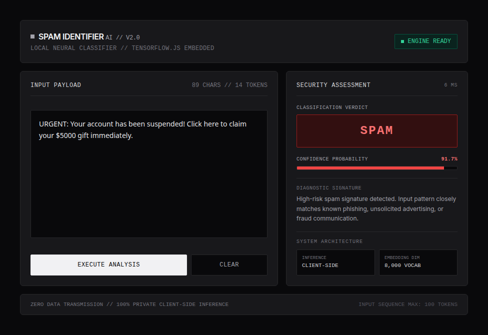
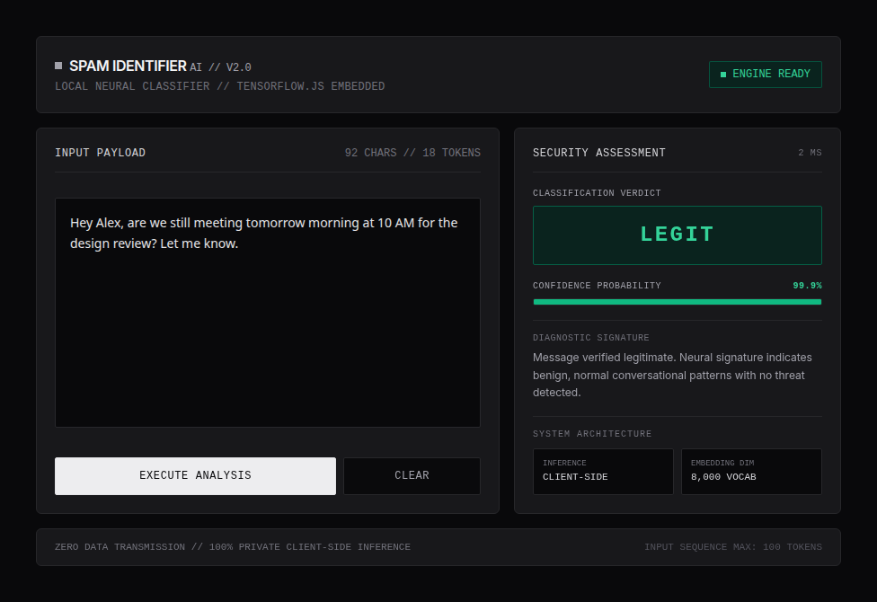

# Spam Identifier AI - Advanced Neural Spam Classification Engine


**Spam Identifier AI** is a high-performance, client-side spam detection engine powered by Deep Learning. By leveraging **TensorFlow.js**, the neural network model runs directly inside the client's browser with WebGL hardware acceleration, guaranteeing that messages remain 100% private and never leave your device.

🚀 **[View Live Demo](https://spamclassifier.vercel.app/)**

---

## 📸 Interface Preview

### Spam Threat Assessment (High Confidence Detection)


### Legitimate Message Verification


---

## 🌟 Key Features

*   **100% Privacy-First Architecture**: All tokenization, embedding lookups, and neural network inference execute locally in your browser. Zero data transmission to external servers.
*   **Utilitarian Bento-Grid Interface**: High-contrast, minimalist dark-mode design engineered for clarity, featuring monospace typography (`JetBrains Mono`), diagnostic telemetry, and zero visual distractions.
*   **Deep Learning Neural Engine**: Keras-trained sequential neural network with embedding projection and global pooling, converted to optimized TensorFlow.js web binaries.
*   **Live Input Diagnostics**: Real-time character and token counter, sub-10ms inference latency tracking, and confidence probability meters.
*   **Robust Memory Management**: Fully scoped WebGL tensor lifecycles using `tf.tidy()` and explicit memory deallocation to prevent browser memory leaks.

---

## 🛠️ Technology Stack

*   **Frontend**: HTML5, Vanilla JavaScript (ES6+), TailwindCSS
*   **Typography**: Inter (Body), JetBrains Mono (Telemetry & Metrics)
*   **Machine Learning**: TensorFlow (Keras) & TensorFlow.js (`v4.17.0`)
*   **Hosting & Deployment**: Vercel

---

## 📂 Project Structure

```bash
Spam_classifier_App/
├── assets/
│   ├── screenshot_spam.png     # Interface screenshot (SPAM verdict)
│   └── screenshot_legit.png    # Interface screenshot (LEGIT verdict)
├── tfjs-env/
│   └── src/
│       ├── index.html          # Bento-grid web application
│       ├── script.js           # Client-side inference & UI state engine
│       ├── spam_model.h5       # Source Keras model weights
│       ├── tokenizer.json      # Word-to-index vocabulary (8,000 vocab limit)
│       ├── convert_to_js.py    # Utility to convert Keras .h5 -> TFJS
│       ├── spam_classifier.ipynb # Model training & evaluation notebook
│       └── tfjs_model/         # Converted web-ready model artifacts
│           ├── model.json
│           └── group1-shard1of1.bin
└── README.md
```

---

## 🚀 Getting Started Locally

To run this project on your local machine:

1.  **Clone the repository:**
    ```bash
    git clone https://github.com/Bishal-Stha/Spam_classifier_App.git
    cd Spam_classifier_App
    ```

2.  **Navigate to the web source:**
    ```bash
    cd tfjs-env/src
    ```

3.  **Start a local development server:**
    *Using Python:*
    ```bash
    python3 -m http.server 8000 --bind 127.0.0.1
    ```
    
    *Using Node.js:*
    ```bash
    npx http-server -p 8000 -a 127.0.0.1
    ```

4.  **Open in Browser:**
    Navigate to `http://127.0.0.1:8000`.

---

## 🧠 Model Conversion Workflow

If you want to train your own model and update the web app:

1.  Train your model in Python using TensorFlow/Keras (`spam_classifier.ipynb`).
2.  Save the model as `spam_model.h5` and export `tokenizer.json`.
3.  Convert the Keras model to TensorFlow.js format:
    ```bash
    python convert_to_js.py
    ```
    or directly via CLI:
    ```bash
    tensorflowjs_converter --input_format keras spam_model.h5 tfjs_model
    ```

---

## 🤝 Contributing

Contributions are welcome! Please feel free to open an issue or submit a Pull Request.

---
*Built with precision using TensorFlow.js*
